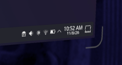
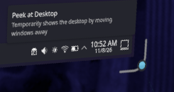

# firtoz's Frametop customizations

This is the change log for the personal integration branch, `firtoz/frametop:main`.
It lists the extra behavior maintained here, not Frametop's complete upstream feature set.
Follow each PR link for its current review/merge status; a submitted PR is not necessarily in upstream yet.

| Customization | Upstream contribution |
| --- | --- |
| Keyboard focus follows controller selection of native windows | [Frametop/frametop #87](https://github.com/Frametop/frametop/pull/87) |
| Configurable drag-zone padding, preview, styling and hover haptics | [Frametop/frametop #92](https://github.com/Frametop/frametop/pull/92) |
| Crisp, configurable resize-corner feedback and hover haptics | [Frametop/frametop #94](https://github.com/Frametop/frametop/pull/94) |
| Per-app native dashboard launch exceptions (Konsole) | Local development; no upstream PR yet |
| App-preserving Steam PIN access protection | Isolated `feat/steam-pin-lock`; upstream PR pending enforcement/headset validation |

## Controller-selected native windows get keyboard focus

After typing in a Frametop window, selecting a native SteamOS window with a controller laser now hands physical-keyboard input back to that window. Previously, a separate 3D-mouse click was needed. The ProtoArc keyboard/touchpad should use **Keyboard + 3D pointer** (`combo`) mode to avoid duplicate typing.

The fix reuses the dashboard focus-stack reader, without intercepting controller buttons. It was manually tested by switching typing between a Frametop text field and native Konsole with the controller alone. See [PR #87](https://github.com/Frametop/frametop/pull/87) for implementation and validation details.

## Configurable drag zones

The move bar also has optional, default-on hover haptics (`GRAB_BAR_HAPTICS`): one pulse per actual physical-controller hover entry/source change, never the other controller or virtual pointer. This follow-up belongs to the drag-zone contribution in [PR #92](https://github.com/Frametop/frametop/pull/92), independently of the resize-corner contribution.

The haptic follow-up is published at `aa92235`; its ARM64 image builds, 38 relevant checkout tests and changed-file Ruff pass, and available C/C++ checks pass with dependency-related hand/gaze skips. It has not yet been activated or wearer-tested on hardware.

Later wearer validation: installed the move-bar haptic follow-up with an approved Frametop desktop restart; the wearer confirmed it works well. SteamVR remained running.

**Frametop Display Settings → Visibility & pins → Window controls** provides:

- Independent horizontal and vertical padding in **centimetres per side**, from 0 to 50 cm; default 2 cm. For example, 2 cm horizontal padding makes the target 4 cm wider than the visible pill.
- No multiplier mode. The visible pill continues to auto-size, but the added physical padding stays fixed.
- **Show drag zone**, with a translucent fill and thin outline.
- **Keep drag zones visible**, while their panels are visible; it does not force other buttons to stay visible or bypass hiding/pausing.
- Independent fill/outline colors and opacity, plus outline thickness.
- Live changes, persisted in the configuration file. Targets remain clear of content and neighboring buttons.

See [Floating windows](floating-windows.md) for configuration keys and details.

Validation: manually exercised on the headset; the clean contribution passed a full ARM64 image build, all `just test-c` checks and changed-file Ruff. Relevant Python tests passed (42 in the checkout; 40 in the image, where the two documentation checks skip without Git metadata). See [PR #92](https://github.com/Frametop/frametop/pull/92) for details and broader-suite limitations.

### Screenshots

Settings UI captured directly, without VR projection, using the current preferences:

Actual VR drag-zone preview, cropped from the headset view:

Only these two wearer-reviewed crops are published. The uncropped capture stays in ignored local artifacts; screenshot review is required before publishing new captures, which may include private windows or room imagery.

## Crisp resize corners

Published independently as [PR #94](https://github.com/Frametop/frametop/pull/94), based directly on clean upstream `main`, without drag-zone, keyboard-focus or native-dashboard-routing changes. Clean contribution `32dff5c` passes a full ARM64 image build (`frametop:resize-controls-pr`, image `15d44fa9fe5e`), 33 relevant checkout Python tests, changed-file Ruff and available C/C++ checks (dependency-related hand/gaze skips as above).

Personal integration `91cf7f1` also passes a full ARM64 image build (`frametop:firtoz-main`, image `b0a95d08177b`), 44 relevant checkout Python tests, changed-file Ruff and available C/C++ checks with the same dependency skips. Subsequent commits only update this log and contribution links. Publishing does not install the new move-bar haptics or restart headset services.

The wearer tested the final defaults, shaped target, controller-mask correction and resize haptics and approved the result. The two exact native-size crops below are approved for publication; full captures remain private. See [Resize corners](resize-corners.md) for the current settings guide. The older installation notes below record development history, not outstanding wearer-review requests.

Idle:

Actual controller hover:

Original/defaults/haptics follow-up: **Soft glow (original behavior)** now restores the unchanged original glow renderer, automatic proximity fade and square hover target, near-hand tab and pointer-edge behavior; it ignores new appearance, shape, exclusion and persistent-corner settings without erasing them. New defaults match the wearer's saved setup: SteamOS-like, bottom-right always visible, 27% opacity, 4.7 cm arms, 5.1 mm thickness, 3.1 cm gap, 2.4 cm hover padding, preview off. Optional hover haptics default on and gate a short pulse to the physical controller identified by the actual hover event, never the other controller or virtual pointer. Both source builds, all 43 relevant Python tests and changed-file Ruff pass; the full C/C++ recipe passes available checks, with dependency-related ncnn/gaze skips as above. Installed from source at `cc5ff72` with wearer-approved desktop and pointer-service restarts; both running binaries match the builds. SteamVR was not restarted. Wearer validation remains pending, including whether the hardware pulse feels right.

Controller-collision follow-up: the mask had been sent in bottom-up UV coordinates instead of top-left image coordinates, vertically mirroring controller collision relative to the preview. Convert circles and rectangles correctly at the OpenVR boundary, and keep the invisible texture, mouse scale and mask at the same 256×256 size. Screen/pointer builds and geometry/protocol regression tests pass, including converted-mask equivalence across all four corners. Installed from source at `f355065` with the wearer-approved desktop restart; the running binary matches the build. SteamVR and the pointer helper were not restarted. Wearer validation remains pending.

Shape-target correction: replaces the offset square with padding around the actual corner path, including both arms and the rounded bend, using a stable envelope around all hover-animation states. **Hover padding around outline** defaults to 1 cm; **Screen exclusion margin** defaults to 0.5 cm. The outline moves farther outward automatically when needed to protect that margin. Controller masks, 3D-pointer filtering and the preview share the same bounded primitive union. Near-hand grab reach is unchanged. Both components build; geometry/protocol tests, all 41 relevant Python tests and changed-file Ruff pass. The full C/C++ recipe passes its available checks (ncnn-linked hand tests and one gaze test skip because their build dependencies are absent in this test container). Installed from source at `2823d1f` with wearer-approved desktop and pointer-service restarts; both services are active and both running binaries match the builds. SteamVR was not restarted. Wearer review remains pending; no new captures have been published.

Latest follow-up: 3 mm default outline thickness (saved choices preserved), reversible 180 ms eased hover animation, a diagnostic hover-target preview checkbox, and independent always-show checkboxes for all four corners. Multiple persistent corners are visual-only; the existing interactive target still follows the approached corner. Visibility never bypasses hidden/minimized/paused panels. Tests cover all 16 persistent-corner combinations, settings persistence/live IPC, animation endpoints/reversal and diagnostic rendering. The screens build, rendering checks, all 40 relevant settings/documentation tests and changed-file Ruff pass. Installed from source at `f162018` with the wearer's approval to restart only the Frametop desktop; the running binary matches the build. Visual wearer review remains pending.

An additional **Native-like** style offers gray-to-almost-white hover feedback, slightly longer/thicker arms and a 3 mm outward shift without changing the target. **Corner roundness** is configurable for both outline styles. These are approximations of the wearer's native-window reference, not reused native controls. Rendering tests cover both styles, square/intermediate/round bends, hover growth/shift and canvas bounds.

Follow-up: the sharp outline defaults to a 2 cm clear gap. Gap, actual laser hover-target size and approach-preview radius are independently configurable. Actual hover/drag uses a distinct configurable color, full configured opacity and a 60% thicker sharp outline, rather than only the approach fade. Native controls and near-hand reach remain unchanged. Rendering checks include gap clearance at 0/2/10 cm and distinct hover styling; the screens build and all 39 relevant settings/documentation tests pass. Installed from source at `c3906b6`, with the wearer's approval to restart only the Frametop desktop; the running binary matches the build. Visual wearer review remains pending.

Replaces Frametop's diffuse corner halo with a sharp, antialiased rounded outline. The indicator still follows any of the four corners; the resize interaction is unchanged. **Display Settings → Visibility & pins → Resize corners** offers sharp/original-glow styles, color, opacity, and sharp-outline arm length and thickness. See [Floating windows](floating-windows.md) for keys and defaults. The screens component builds; rendering checks cover all four orientations, extreme dimensions, antialiasing and a clear panel interior. All 39 relevant settings/documentation tests and changed-file Ruff pass. Local screenshot evidence stays private pending review; headset validation is pending.

## Native Konsole from the dashboard

`DASHBOARD_NATIVE_APPS='konsole'` leaves Konsole picked from SteamVR's **+** menu on SteamVR's original/native launch path even while other dashboard apps route into Frametop. It changes where new windows open, not their distribution: Konsole in Frametop already runs on the SteamOS host, not Fedora. The setting is checked per launch, matches exact executable basenames and preserves other apps' routing. Tests cover executable paths, simple environment wrappers, argument false positives, multiple exceptions and preserving the original command line. Existing windows are not moved. See [Floating windows](floating-windows.md) for configuration details.

## Steam PIN access protection

Experimental, opt-in `STEAM_PIN_LOCK=1` keeps Frametop's desktop, floating windows and input inaccessible when Steam's six-digit PIN is active or the observer's evidence is unknown/stale. Apps and unsaved work remain running. The independent lease expires after 750 ms and detects suspend. The observer is strictly passive: Steam alone locks, unlocks and presents its PIN UI. A restarted observer stays denied until it observes a genuine Steam lock/unlock cycle rather than trusting an absent prompt or requesting authentication. Protected mode requires the screens backend and disables remote serving and notification forwarding for the whole session. Audio and background jobs continue. This protects the locked-headset interface, not against malicious same-user software. See [Steam PIN protection](steam-pin-lock.md) for limitations and validation requirements.

The clean contribution starts at `4b4fa17` on `feat/steam-pin-lock`, based on clean upstream `main`. Its full ARM64 image build passed. Two real Steam PIN cycles validated detection. The gate now has 30 offline tests, including deterministic guard-loop scheduling/suspend/slow-response checks added in `1527d7b`; targeted container tests and available native checks pass, with baseline/input-fixture limitations documented in the guide. The personal integration also builds and passes its resize/drag/PIN native checks, 68 targeted Python tests (one container-only documentation skip), and the initial 28 host-side gate/documentation tests without skips. The expanded host-side gate/documentation/session/installer group passes 73 tests.

Installed integrated commit `355089b` from the source checkout using its own build scripts, with `STEAM_PIN_LOCK=1` and the guard unit installed through the shared installer helper. The wearer approved the one-time desktop/input/keyboard restart; SteamVR remained running. The live compositor and keyboard hashes matched the new builds. The guard reported locked, then unlocked after the wearer authenticated; readbacks reported the desktop screen and controls visible. The initially missing screen was behind the wearer at its saved position; bringing screen 1 in front resolved that without a restart.

The wearer then opened KWrite with unsaved text and completed another real Steam PIN lock/unlock cycle. They confirmed Frametop disappeared while locked, returned after unlock, and retained the unsaved text. KWrite, nested KWin and the compositor kept the same processes. This passes the basic visual/app-preservation check; input-blocking, auxiliary panels, timing, observer/UI failure, boot and suspend/resume still need hardware validation. No screenshots were taken. The separate upstream contribution will remain draft pending that matrix.

The subsequent floating-window cycle exposed repeated PIN prompts in the initial active-recovery implementation. While locked, readbacks confirmed no Frametop overlays visible and all baseline processes alive; Full Keyboard was not visible before that test, so its concealment remains unvalidated. A monitored repeat showed a clean cycle but did not establish the earlier failure's exact cause. At the wearer's request, clean-branch fix `c3f50e4` (integrated as `c36f954`) removes all lock requests and adds fixed diagnostic reason codes. It passes 35 PIN tests and 78 targeted host-side tests, plus changed-file Ruff. With explicit approval, only the guard was restarted to load this revision. It correctly reported unknown/awaiting-observed-lock and hid every Frametop panel without creating a Steam PIN prompt. The wearer then used Steam's enabled PIN-on-wake flow by sleeping/waking with the headset power button and confirmed it worked. Logs showed unknown/observation-gap-or-suspend → locked → unlocked-after-observed-lock, and the original KWrite, KWin, compositor and keyboard processes remained alive. This validates passive recovery through that normal sleep/wake cycle; cold boot, prolonged suspend and other failure/input cases remain pending. No desktop/app restart was needed.

## Branch workflow

Steam PIN work is being validated in a separate integration worktree so testing retains the fork's resize controls, drag-bar changes and native-dashboard routing. The clean upstream branch contains none of those unrelated customizations.

- **`origin`** points to `firtoz/frametop`; it is the default push destination.
- **`main`** integrates the personal customizations and this log. Never submit it wholesale to upstream.
- **`upstream`** points to `Frametop/frametop`; its push URL is deliberately disabled.
- **`upstream-main`** tracks upstream's clean `main` and has a matching branch on the fork. Update it by fast-forwarding, not by adding personal commits.
- **PR branches** start from the clean tracking branch and contain only the relevant feature/fix. The personal README notice, this log and fork-specific agent instructions stay out of upstream PRs.

Periodically fetch upstream and update the tracking branch, then integrate those changes into personal `main`. Rebasing an already published `main` rewrites history and needs explicit approval and a guarded `--force-with-lease` push; merging is the non-rewriting alternative. After a PR merges, check whether its local commits can be dropped during the next rebase.

The generic installer/updater in the upstream README targets upstream. Do not use it as an update mechanism for this customized branch without checking what it will replace.

## Maintaining this log

For every new customization, add or update its entry, behavior summary, configuration location, upstream PR link and validation notes. Link approved screenshots where useful. Keep entries when their PR merges, marking them as integrated rather than silently losing the history. Keep fork-only documentation separate from contribution branches.
